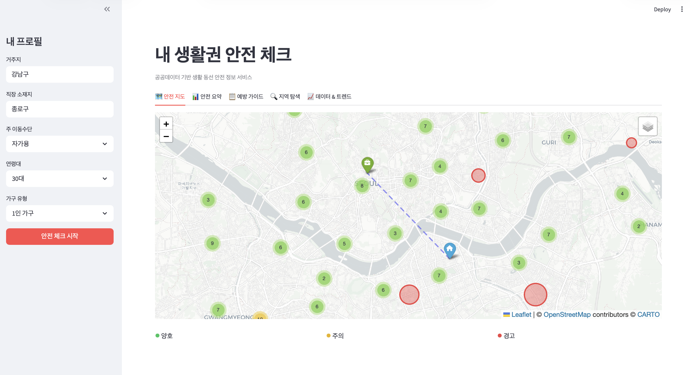
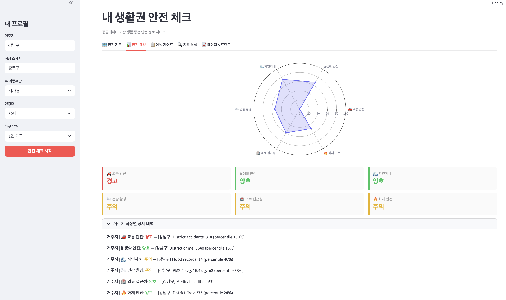
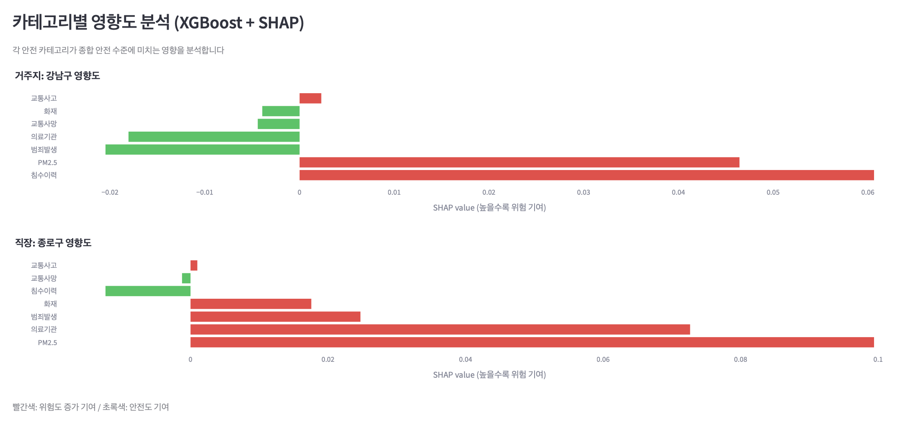
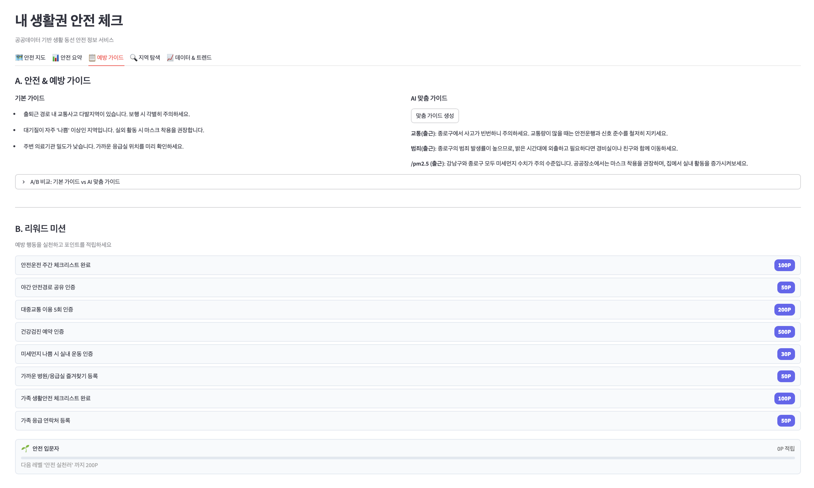
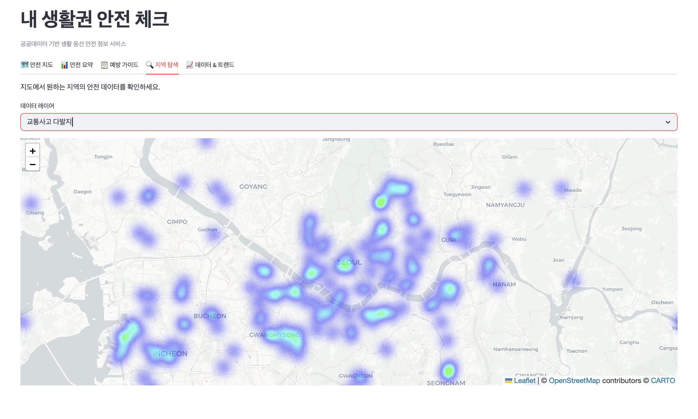
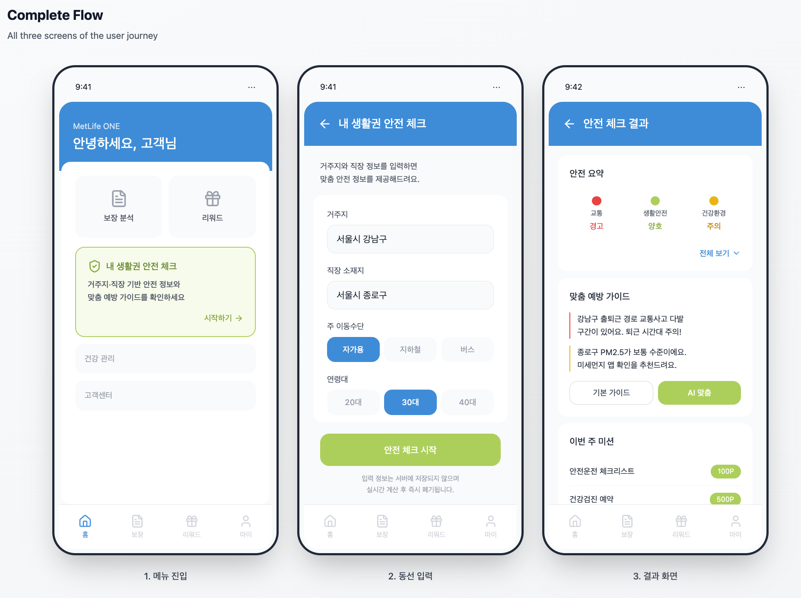

# Lifestyle Safety & Reward Planner

> 공공데이터 기반 생활권 안전 정보 + AI 맞춤 예방 가이드 + 리워드 미션 연동 서비스 프로토타입

**Independent Project** · MetLife ONE 앱 서비스 기획 데모

---

## 목표

MetLife ONE 앱 고객이 **자신의 생활 동선(거주지·직장·출퇴근)에 대한 안전 정보를 쉽게 확인**하고, **구체적인 예방 행동 → 리워드 미션 → 보장 점검**으로 자연스럽게 연결되는 서비스 프로토타입을 구축한다.

핵심 원칙:
- **Wellness & Prevention**: 보험료·인수심사 도구가 아닌 예방 중심 서비스
- **"안전 정보"**: "리스크 점수"가 아닌 긍정적 프레이밍
- **위치 정보 미저장**: 실시간 계산 후 즉시 폐기

---

## JD 매핑

| JD 업무 | 프로젝트 대응 |
|---|---|
| MetLife ONE용 공공데이터 기반 생활밀착형 서비스 기획 | 6개 공공데이터 → 안전 정보 + AI 맞춤 가이드 |
| UI/UX 기획 지원 | Streamlit 5탭 대시보드 + Figma 앱 목업 3화면 |
| 리워드 프로그램 운영지원 및 RPA | 리워드 미션 gamification + 레벨 시스템 + 데이터 자동 갱신 |

---

## 아키텍처

```
[사용자 입력]
거주지 / 직장 / 이동수단 / 연령대 / 가구 유형
※ 서버 미저장, 실시간 계산 후 폐기
         |
         v
[Layer 1: 공공데이터 안전 정보 조회]
|-- 교통 안전 (도로교통공단 TAAS API)
|-- 생활 안전 (경찰청 KOSIS)
|-- 자연재해 (서울시 침수이력)
|-- 건강 환경 (에어코리아 API)
|-- 의료 접근성 (건보심평원)
|-- 화재 안전 (소방청)
         |
         v
[Layer 2: 안전 수준 산출]
|-- 최근접 구(sigungu) 매칭
|-- 서울시 전체 구 분포 대비 백분위 순위
|-- 가중 평균: 거주지 50% + 직장 30% + 출퇴근 15% + 기타 5%
|-- XGBoost + SHAP 카테고리별 영향도 분석
         |
         v
[Layer 3: 3갈래 출력]
|-- (A) 안전 & 예방 가이드
|       |-- Rule-based 기본 가이드
|       |-- LLM 맞춤 가이드 (Ollama Qwen 2.5 / Anthropic Haiku fallback)
|       |-- A/B 비교 평가 패널
|-- (B) 리워드 미션
|       |-- 카테고리 트리거 미션 (8개)
|       |-- 포인트 적립 + 레벨 시스템 (입문자→실천러→매니저→마스터)
|-- (C) 보장 점검 체크리스트
         |
         v
[Layer 4: 생활권 안전 맵]
Folium 지도 + 동선 오버레이 + 히트맵 + 레이어 전환
```

---

## 주요 기능

### 1. 생활권 안전 지도 (Tab 1)
거주지·직장 마커 + 출퇴근 동선 오버레이 + 교통사고 다발지 클러스터 + 응급의료기관 레이어.

<p align="center">
  
</p>

### 2. 안전 요약 + XGBoost/SHAP 분석 (Tab 2)
레이더 차트(6개 카테고리) + 양호/주의/경고 카드 + **XGBoost로 학습한 카테고리별 영향도를 SHAP으로 시각화**.

<p align="center">
  
</p>
<p align="center">
  
</p>

### 3. AI 맞춤 예방 가이드 + 리워드 미션 (Tab 3)
Rule-based 기본 가이드와 **LLM(Ollama Qwen 2.5 7B) 맞춤 가이드를 A/B 비교**. 카테고리별 리워드 미션 + 4단계 레벨 시스템.

<p align="center">
  
</p>

### 4. 지역 탐색 (Tab 4)
교통사고 히트맵, 의료기관 분포, 침수 이력, 대기질 측정소 등 **4개 데이터 레이어를 자유 전환**하며 서울시 전체 탐색.

<p align="center">
  
</p>

### 5. 데이터 & 트렌드 (Tab 5)
6개 공공데이터 출처·갱신 주기 테이블 + 연도별/월별 트렌드 차트 + WHO/환경부 기준선 + 산출 방법 문서.

---

## Figma 앱 목업

MetLife ONE 앱에 서비스가 탑재될 때의 **사용자 플로우를 3개 화면으로 설계**. 와이어프레임 수준.

<p align="center">
  
</p>

**[Figma 프로토타입 보기](https://www.figma.com/make/R4hmCElWRGuARXI5qmzVwu/Create-mockup?t=iSKhGO5mHiHIBOJL-20&fullscreen=1)**

| 화면 | 설명 |
|---|---|
| 1. 메뉴 진입 | MetLife ONE 홈 → "내 생활권 안전 체크" 진입 카드 |
| 2. 동선 입력 | 거주지 / 직장 / 이동수단 / 연령대 + 개인정보 미저장 안내 |
| 3. 결과 화면 | 안전 요약 → 맞춤 예방 가이드(기본/AI 토글) → 리워드 미션 → 보장 점검 체크리스트 |

---

## 데이터 소스

| 카테고리 | 소스 | 수집 방식 | 갱신 주기 | 비고 |
|---|---|---|---|---|
| 교통사고 다발지점 | 도로교통공단 (TAAS) | **API** (data.go.kr) | 연간 | 1,242건 실데이터 수집 완료 |
| 대기질 | 에어코리아 | **API** (data.go.kr) | 시간 | 서울 25개 구 실시간 PM2.5/PM10 |
| 범죄 발생 통계 | 경찰청 | CSV (KOSIS) | 연간 | 파서 구현 완료 |
| 침수 흔적도 | 서울시 열린데이터 | CSV | 수시 | 파서 구현 완료 |
| 의료기관 분포 | 건보심평원 (HIRA) | CSV | 월간 | 파서 구현 완료 |
| 화재 통계 | 소방청 | CSV (KOSIS) | 연간 | 파서 구현 완료 |

---

## 기술 스택

```
Python 3.10 | PostgreSQL 16 (Docker) | CSV Fallback (Streamlit Cloud 배포용)
XGBoost + SHAP (카테고리 영향도 분석)
Ollama (Qwen 2.5 7B) + Anthropic Haiku (LLM 맞춤 가이드)
Folium + geopandas (공간 분석 및 지도)
Plotly + Streamlit (대시보드)
Figma (앱 UI/UX 목업)
공공데이터포털 API + KOSIS CSV
```

---

## LLM 통합: Rule-based vs AI 맞춤 A/B 비교

| 항목 | 기본 가이드 (Rule-based) | AI 맞춤 가이드 (LLM) |
|---|---|---|
| 생성 방식 | 카테고리 × 안전 수준 템플릿 매칭 | 프로필 + 안전 데이터 → LLM 자연어 생성 |
| 구체성 | 범용 ("교통사고 다발지역 주의") | 지역 특정 ("강남구 퇴근 시간대 사고 다발") |
| 백엔드 | 없음 (즉시) | 1차: Ollama 로컬 (비용 0) / 2차: Anthropic Haiku |
| 평가 | A/B 비교 패널에서 사용자가 직접 평가 | 구체성·실행 가능성·톤 3개 기준 |

---

## 리워드 미션 Gamification

### 미션 구조

| 안전 카테고리 | 미션 | 포인트 |
|---|---|---|
| 교통 안전 | 안전운전 주간 체크리스트 완료 | 100P |
| 교통 안전 | 야간 안전경로 공유 인증 | 50P |
| 교통 안전 | 대중교통 이용 5회 인증 | 200P |
| 건강 환경 | 건강검진 예약 인증 | 500P |
| 건강 환경 | 미세먼지 나쁨 시 실내 운동 인증 | 30P |
| 의료 접근성 | 가까운 병원/응급실 즐겨찾기 등록 | 50P |
| 가족 활동 | 가족 생활안전 체크리스트 완료 | 100P |
| 가족 활동 | 가족 응급 연락처 등록 | 50P |

### 레벨 시스템

| 레벨 | 뱃지 | 누적 포인트 |
|---|---|---|
| 안전 입문자 | 🌱 | 0P ~ |
| 안전 실천러 | 🛡️ | 200P ~ |
| 안전 매니저 | ⭐ | 500P ~ |
| 안전 마스터 | 🏆 | 1,000P ~ |

---

## RPA: 공공데이터 자동 갱신

```bash
# 대기질만 갱신 (시간 단위 가능)
python scripts/auto_refresh.py --air-only

# 전체 갱신 (CSV 재파싱 + API)
python scripts/auto_refresh.py

# 교통사고 포함 전체 (주간)
python scripts/auto_refresh.py --full

# Cron 예시: 매일 06시 대기질 갱신
0 6 * * * cd /path/to/project && .venv/bin/python scripts/auto_refresh.py --air-only >> logs/refresh.log 2>&1

# Cron 예시: 매주 월요일 전체 갱신
0 6 * * 1 cd /path/to/project && .venv/bin/python scripts/auto_refresh.py --full >> logs/refresh.log 2>&1
```

갱신 결과는 `data/raw/refresh_status.json`에 기록.

---

## Quick Start

```bash
# 1. Clone & Setup
git clone https://github.com/ChangyeolAidenOh/lifestyle-safety-planner.git
cd lifestyle-safety-planner
python -m venv .venv && source .venv/bin/activate
pip install -r requirements.txt
cp .env.example .env

# 2. Sample data 생성
python scripts/generate_sample_data.py

# 3. (Optional) PostgreSQL
docker-compose up -d

# 4. (Optional) LLM - Ollama
ollama pull qwen2.5:7b-instruct

# 5. Dashboard 실행
streamlit run dashboard/app.py
```

---

## 프로젝트 구조

```
lifestyle-safety-planner/
|-- config.py                              # 중앙 설정 (DB, LLM, 가중치, 임계값)
|-- collectors/
|   |-- traffic.py                         # 교통사고 API 수집기 (data.go.kr)
|   |-- air_quality.py                     # 대기질 API 수집기 (AirKorea)
|   |-- crime.py                           # 범죄 통계 CSV 파서 (KOSIS)
|   |-- flood.py                           # 침수 이력 CSV 파서 (서울시)
|   |-- medical.py                         # 의료기관 CSV 파서 (HIRA)
|   |-- fire.py                            # 화재 통계 CSV 파서 (KOSIS)
|-- pipeline/
|   |-- db.py                              # PostgreSQL + CSV fallback
|   |-- safety_scorer.py                   # 구 단위 매칭 + 백분위 안전 수준
|   |-- xgb_explainer.py                   # XGBoost 학습 + SHAP 영향도 분석
|-- llm/
|   |-- backend.py                         # Ollama + Anthropic Haiku 라우터
|   |-- prompts.py                         # 한국어 프롬프트 (wellness 톤)
|   |-- guide_generator.py                 # Rule-based + LLM A/B 가이드 생성
|-- dashboard/
|   |-- app.py                             # Streamlit 메인 (5탭)
|   |-- tabs/
|       |-- tab1_safety_map.py             # Folium 안전 지도
|       |-- tab2_safety_summary.py         # 레이더 차트 + SHAP 분석
|       |-- tab3_action_guide.py           # 예방 가이드 + 리워드 + 레벨
|       |-- tab4_safety_explorer.py        # 히트맵 자유 탐색
|       |-- tab5_data_trend.py             # 트렌드 + 산출 방법
|-- scripts/
|   |-- generate_sample_data.py            # 서울 25개 구 샘플 데이터 생성
|   |-- auto_refresh.py                    # RPA 자동 갱신 (cron 연동)
|   |-- init_db.sql                        # PostgreSQL 3-tier 스키마
|-- data/
|   |-- raw/                               # 수집 원본 데이터
|   |-- sample/                            # 대시보드용 데이터 (CSV fallback)
|-- figures/                               # 스크린샷 및 Figma 목업
|-- .env.example                           # 환경 변수 템플릿
|-- docker-compose.yml                     # PostgreSQL 16
|-- requirements.txt
```

---

## 산출 방법

### 안전 수준 산출
1. 사용자 위치(거주지, 직장)에서 **가장 가까운 구(자치구)를 매칭** (Haversine distance).
2. 해당 구의 카테고리별 수치를 **서울시 전체 구 분포 대비 백분위**로 환산.
3. **가중 평균** 적용: 거주지 50% + 직장 30% + 출퇴근 15% + 기타 5%.
4. 수준 판정: 양호 (하위 33%), 주의 (33~66%), 경고 (상위 33%).

### XGBoost + SHAP 영향도 분석
- 25개 구 × 7개 feature → XGBoost Regressor 학습 (composite safety score 예측).
- SHAP TreeExplainer로 각 구에서 어떤 카테고리가 종합 안전에 가장 크게 기여하는지 시각화.
- XGBoost 2.0+ / SHAP 호환을 위한 3단계 fallback: TreeExplainer → Explainer(callable) → feature_importances_.

### LLM 개인화
- System prompt에 PM2.5 기준값, wellness 톤 규칙 포함.
- 비용 0원 구조: 로컬 Ollama (Qwen 2.5 7B) 1차 → Anthropic Haiku 2차 fallback.
- "양호" 카테고리는 LLM에 전달하지 않아 입력 토큰 절감.

---

## 기술적 도전 과제와 해결

| 과제 | 해결 |
|---|---|
| 공공데이터 해상도 불일치 (지점/관할/측정소) | 최근접 구 매칭 (`match_district`) + 구 단위 비교 |
| XGBoost 2.0 + SHAP 호환 오류 | 3단계 fallback (TreeExplainer → callable → feature_importances_) |
| LLM 응답 길이/품질 불안정 | max_tokens 제한 + "양호 제외" 입력 압축 + 기준값 가이드 |
| Streamlit Cloud에서 Ollama 불가 | LLMRouter 자동 fallback (로컬 → 클라우드) |
| CSV fallback vs PostgreSQL 이중 구조 | `USE_CSV_FALLBACK` 플래그 기반 일급 지원 |

---

## 차별화 포인트

1. **텔레매틱스형 UBI와 차별화**: 센서/장비 없이 공공데이터만으로 생활권 안전 정보 + 리워드 미션 결합
2. **AI Fluency**: Rule-based와 LLM 가이드의 A/B 비교로 AI 도입 실효성 검증
3. **앱 재방문 동기**: 이사/이직/통근 변경 시 재생성 + 주간 미션 → DAU/MAU 향상
4. **JD 3개 업무 전체 커버**: 공공데이터 서비스 + Figma UI/UX + 리워드 gamification + RPA 자동 갱신
5. **비용 0원 LLM**: Ollama 로컬 추론으로 API 과금 없이 개인화 서비스 구현

---

## 기존 프로젝트 자산 전이

| 전이 자산 | 원본 프로젝트 | 매핑 |
|---|---|---|
| 공공데이터 리스크 스코어링 | cnp-voc-pipeline | 위치 → 안전 카테고리 |
| XGBoost + SHAP | sensor-governance-platform | 카테고리 가중치 학습 + 설명 |
| PostgreSQL 3-tier ETL | sportswear-brand-monitor | 공공데이터 파이프라인 (raw → staging → mart) |
| Ollama 멀티 백엔드 패턴 | consumer-signal-agentic-platform | LLMRouter (로컬 → 클라우드 fallback) |
| CSV Fallback 배포 | sportswear-brand-monitor | Streamlit Cloud 무과금 배포 |

---

## 향후 로드맵

- [ ] 서울 외 수도권 (경기/인천) 확장
- [ ] Streamlit Cloud 배포 + 데모 링크
- [ ] 실데이터 전체 교체 (25개 구 × 6개 카테고리)
- [ ] 리워드 미션 완료 인증 UI (카메라/GPS 연동)
- [ ] SHAP Waterfall 차트 추가 (개별 feature 상세)

---

*Independent Project · Changyeol Oh · [GitHub](https://github.com/ChangyeolAidenOh)*
